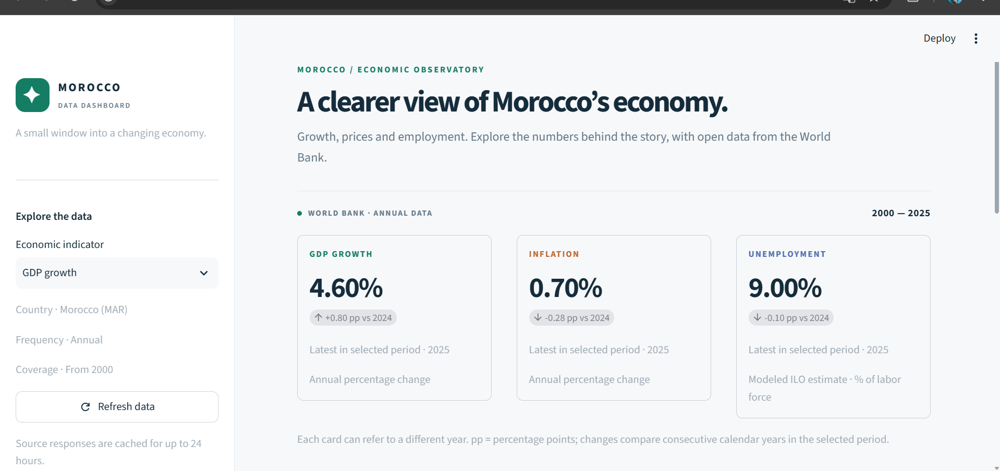

# Morocco Data Dashboard

A Streamlit dashboard for exploring Morocco's economic growth, consumer-price inflation and unemployment using the World Bank's public World Development Indicators API.

Built by [akramatr-48](https://github.com/akramatr-48). This is an independent data portfolio project, not an official World Bank or HCP product.



*Local app screenshot. Values reflect the source response at capture time and can change when the source is revised.*

## What you can do

- View three indicator cards, each with its latest available year inside the selected period.
- Explore annual trends from 2000, choose the indicator and year range, and switch between line and bar charts.
- Inspect the underlying table and export one series or all three as CSV.
- Read definitions, limitations, source links and retrieval timestamps.
- Refresh cached source responses and handle a temporarily unavailable series without losing the others.

## Data provenance

| Indicator | World Bank code | Unit | Source page |
| --- | --- | --- | --- |
| Real GDP growth | `NY.GDP.MKTP.KD.ZG` | Annual % change | [World Bank](https://data.worldbank.org/indicator/NY.GDP.MKTP.KD.ZG?locations=MA) |
| Consumer-price inflation | `FP.CPI.TOTL.ZG` | Annual % change | [World Bank](https://data.worldbank.org/indicator/FP.CPI.TOTL.ZG?locations=MA) |
| Unemployment, modeled ILO estimate | `SL.UEM.TOTL.ZS` | % of total labor force | [World Bank](https://data.worldbank.org/indicator/SL.UEM.TOTL.ZS?locations=MA) |

GDP draws on national accounts, OECD and World Bank estimates. Inflation is published from IMF International Financial Statistics. Unemployment uses ILO modeled estimates. These internationally comparable unemployment estimates **may differ from HCP's national figures**. See the original series metadata for current methodology and attribution.

The app requests country `MAR`, WDI source `2`, and years from 2000 through the current UTC year over HTTPS. Responses are validated for country, indicator, pagination, numeric values and duplicate years. Source data is cached for up to 24 hours. **Refresh data** invalidates that cache. The dashboard does not contain forecasts, generated values, or an offline sample-data fallback.

The latest observation year can differ by indicator and is not necessarily the current year. Source values can be revised and may include estimates. Missing observations remain missing: no zero-filling or interpolation. Cards round for readability; CSV exports retain the source's numeric precision. Deltas are percentage points versus the previous calendar year within the selected period; no delta is shown when that year is missing. A lower inflation rate does not necessarily mean lower prices.

Data attribution: World Bank, World Development Indicators, [CC BY 4.0](https://creativecommons.org/licenses/by/4.0/). No endorsement by the data providers is implied.

## Run locally

Developed and tested with Python 3.12. Internet access to `api.worldbank.org` is required for real observations.

On Windows, double-click **RUN_DASHBOARD.bat** from the project folder. It creates a local environment if needed, installs the requirements and starts Streamlit. Python must be installed and available as `python`.

Or use a terminal from the project folder:

```powershell
python -m venv .venv
.\.venv\Scripts\python.exe -m pip install -r requirements.txt
.\.venv\Scripts\python.exe -m streamlit run app.py
```

On macOS / Linux:

```bash
python3 -m venv .venv
.venv/bin/python -m pip install -r requirements.txt
.venv/bin/python -m streamlit run app.py
```

Open the local URL printed by Streamlit. Stop the app with Ctrl+C in its terminal.

If Windows Application Control blocks a compiled library, keep the protection enabled and investigate the specific blocked file. An isolated environment resolved the initial local installation issue in this project, but it is not a guaranteed fix for every policy.

## Tests

```powershell
.\.venv\Scripts\python.exe -m unittest discover -s tests -v
```

The suite covers source validation, missing observations, calendar-year deltas, CSV exports and Streamlit user flows (indicator, period, chart style, partial failure and offline state). Tests use explicit synthetic fixtures **only inside the tests**; they do not validate current World Bank values or inject samples into the app. GitHub Actions runs the same checks on pushes and pull requests.

## Publish

1. Commit these source files to `akramatr-48/morocco-data-dashboard` on branch `main`. Never upload `.venv/`, secrets or cache files.
2. Sign into [Streamlit Community Cloud](https://share.streamlit.io/) using your GitHub account.
3. Create an app and choose the repository above, branch `main`, and entrypoint `app.py`.
4. In advanced settings, choose Python **3.12**, then deploy. No secrets or API keys are needed.
5. Once deployment succeeds, add its actual public URL to the repository's About section.

See [Streamlit's deployment guide](https://docs.streamlit.io/deploy/streamlit-community-cloud/deploy-your-app/deploy). This source package is ready for deployment; a public app URL must only be recorded after a successful deployment.

## Project structure

```text
morocco-data-dashboard/
├── app.py                      # Streamlit interface and charts
├── indicators.py               # Codes, definitions and source links
├── data_loader.py              # Validated World Bank API requests
├── analytics.py                # Metrics, tables and CSV transformations
├── assets/style.css            # Responsive visual styling
├── .streamlit/config.toml      # Theme and telemetry preference
├── tests/                      # Data and interaction checks
├── .github/workflows/checks.yml
├── requirements.txt
├── RUN_DASHBOARD.bat
├── .gitignore
└── LICENSE
```

## Skills demonstrated

Python · REST APIs · source validation · pandas · time-series visualization · Altair · Streamlit · CSV exports · error handling · automated UI tests · GitHub Actions

## License

Application code: MIT (see [LICENSE](LICENSE)). Source data retains the World Bank's attribution and licensing requirements.
